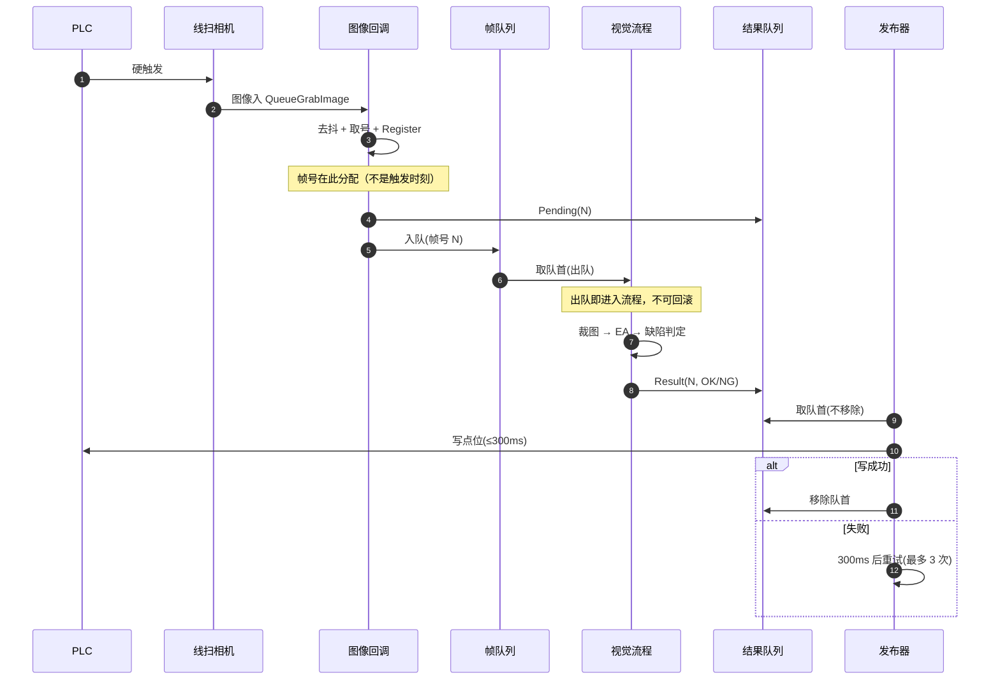
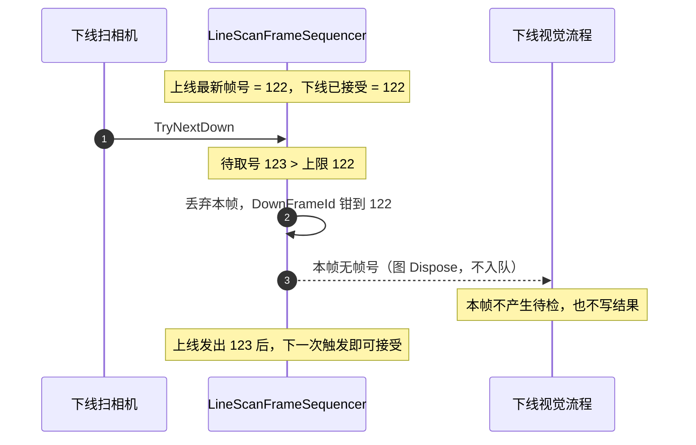
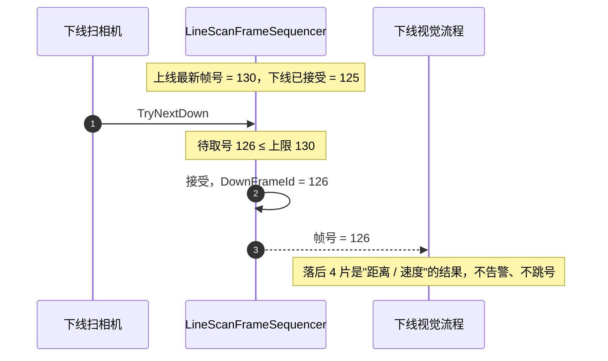
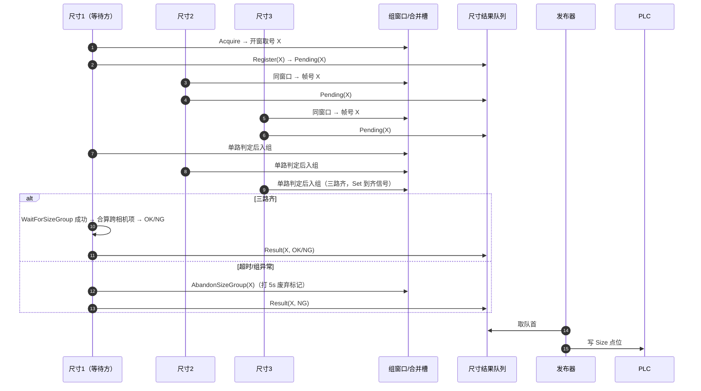
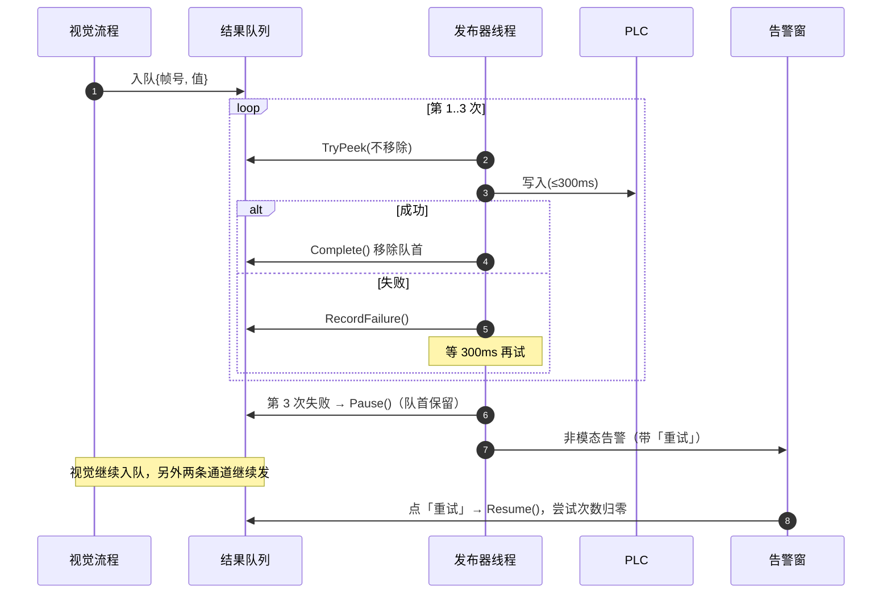

# 五金模切 帧队列与 PLC 结果发布 — 当前实现说明

> 文档性质：**对当前代码实现的描述**，所有行为以代码现状为准。
> 适用范围：**仅五金模切**（`MaterialCrafEnum.五金模切`）。激光模切走 `DieCutProDevice` / `Server_DieCuttingCut`，
> 两条链路不共用序号器、结果队列与点位表，本文所述行为不适用于激光。

> **2026-11-27 运行控制重构**：运行态改为 Idle / Running / Paused 三态，开始/结束膜卷是总开关，
> 暂停不再走硬停（不清队列、不写 0、不停发布器）。本文 §2.5、§5.8、§7.4、§8.1 已同步；
> 完整运行控制说明见 `docs/五金模切_运行控制设计.md`。

## 0. 一句话模型

视觉侧按"帧"处理并产出结论；PLC 侧按"帧序"发布结论。
两侧通过**帧号**关联、通过**结果队列**解耦：视觉入队即结束，不等 PLC；PLC 位点是标量，只保存当前值。

## 1. 术语

| 术语 | 含义 | 代码对应 |
|---|---|---|
| 帧 | 一台相机一次触发产生的一张图 | — |
| 帧号 FrameId | 产品在该工位的序号，从 1 开始 | `ImageInfo.image_ID` |
| 工位 | 线扫工位（上线扫 + 下线扫）、尺寸工位（尺寸1/2/3） | `FrameStation` |
| 帧队列 | 某台相机"已触发、未开始处理"的图，FIFO | `alreadyDealGrabImage` |
| 结果队列 | 某工位"已判定、未发布"的结论，FIFO | `PlcResultChannel` |
| 判定 | 视觉流程得出 OK/NG 的过程 | `ProcessEaImage` / `ProcessSizeStation` |
| 发布 | 把结论写入 PLC 结果点位 | `PlcResultPublisher` |
| 待检 | 结果点位的值 3，表示"已触发、结论未出" | `PlcResult.Pending` |

## 2. 帧号

### 2.1 分配点与去抖

帧号在**图像入队时刻**分配，不在触发时刻分配：

```text
相机出图 → QueueGrabImage → CallBackImgDataDeal（回调线程）
    ├─ 无流程在跑（Project.GetStates()==false）→ 直接 Dispose，不入队
    └─ 出队 → TryAssignFrameId()
            ├─ 返回 false（无效图 / 去抖拒绝）→ 调用方 Dispose，不入队、不占号
            └─ 返回 true → 写 image_ID → Register(帧号) → 入 alreadyDealGrabImage → Release 信号量
```

- 五金覆写的是 `TryAssignFrameId`，不是 `CallBackImgDataDeal`；基类 `BaseProParam` 只多了一个虚方法，激光仍走基类的"每相机自增"实现。
- 去抖是每个五金 Param 内部一个 `FrameTriggerGate`（阈值 50ms），判在 `TryAssignFrameId` 内。同一相机 50ms 内的第二次触发被丢弃图、不占号、不提示。
- 时钟用 `Stopwatch` 毫秒（`MonotonicClock`）：`DateTime` 的 15.6ms 取整会把 60ms 判成 46ms。
- 帧号与"触发"没有关系：PLC 触发与图像回调是两条路径，用触发侧的预测值当帧号会在丢图时永久错位。

### 2.2 唯一来源

- 五金不使用基类的 `nCurProImgId`：覆写后该字段不再参与。
- 线扫与尺寸各一套序号器：`五金模切帧序号.LineScan`、`五金模切帧序号.Size`，二者互不读取、互不联动。
- `nEAId` 仍在裁图流程里自增，只用于显示（`m_nProductID`、EA 图描述），不参与任何配对或发布。

### 2.3 工位内共享

| 工位 | 共享方式 |
|---|---|
| 线扫 | 上线与下线共用一个 `LineScanFrameSequencer`；上线是源头，下线与其对齐（见 3.2） |
| 尺寸 | 三路共用一个 `SizeFrameSequencer`，按组窗口取号（见 4.2），同一组必然同号 |

### 2.4 不变式

```text
下线帧号 ≤ 上线最新帧号
尺寸帧号：同组三路相等；不同组不相等
```

- 固定的只有**两台相机的安装距离**。上下线之间的片差 = 距离 / 速度，随皮带速度与帧触发节拍变化，
  不是常数，因此不做断言，也不参与任何判定。
- 「上线最新帧号」是 `LineScanFrameSequencer._upFrameId` 这个**标量**，不是帧队列尾部元素：
  帧出队进入流程后会从 `alreadyDealGrabImage` 移除，队列可能为空。读队列会把"上线在跑但队列空"
  误判成"上线没有帧"，从而把下线帧全部丢掉。

### 2.5 暂停、开始与结束膜卷

| 事件 | 序号 | 代际 | 帧有效集 |
|---|---|---|---|
| 暂停（`Pause`） | **不动**：恢复后接着原来的片序跑 | **不动** | 保留 |
| 继续（`Resume`） | 不动 | 不动 | 保留 |
| 结束膜卷 | 下一次开始从 1 重新数 | +1（由 `INIProduct` 的 `帧序号.Reset` 完成） | 清空 |
| 开始膜卷 | 归 1 | +1 | 清空 |

- 暂停只挂起流程线程，不调用 `StopRun`、不写 PLC、不 bump 代际、不停发布器、不清队列；
  自动模式帧继续入队（每相机上限 8 帧），仿真模式冻结触发。
- `五金模切帧序号.Stop()` 仍是低层硬停的一部分，只由结束膜卷/回滚调用；界面不再提供“停止”按钮。
- 结束膜卷先暂停→等当前帧→检查未处理项→确认→停流程/发布器/写 0/清场；取消保持暂停。

### 2.6 帧号 0 的含义

0 表示"该工位尚未有产品"，不是合法帧号。发布与配对都以 `frameId > 0` 为前提：
`Abandon` 对 `<=0` 直接返回，`IsLive` 里也不会出现 0（除非上层把 0 登记进来，见 §4.2 的现状说明）。

## 3. 线扫工位

### 3.1 帧队列

- 上线扫、下线扫各一条帧队列（各自的 `alreadyDealGrabImage`），队列本身带锁（`QueuePackage`）。
- 流程线程先 `semaphoreSlimCam.Wait(50)` 再检查队列非空、取队首（`Dequeue`）。信号量只作节拍提示，队列非空才是出队依据。
- 出队发生在处理开始时刻；出队之后即"已进入流程"，停机或异常都不回滚该帧，只能丢弃或判 NG。
- 队列长度 = 待处理积压量，不表示"处理中/已完成"。

### 3.2 下线与上线对齐

下线不是自由计数，也不按固定片差推算。它只受一条约束：**不能超过上线已经发出的最大帧号**。
落后多少片由"安装距离 / 皮带速度"决定，是可变量，不作为故障判断依据。

```text
待取号 = 下线已接受帧号 + 1
上限   = 上线最新帧号（_upFrameId）
```

| 条件 | 动作 | 本帧帧号 | 告警 |
|---|---|---|---|
| 上限为 0（上线还没出过帧） | 静默丢弃（`启动预热`），图 Dispose | — | 不提示 |
| `待取号 ≤ 上限` | 接受 | `待取号` | — |
| `待取号 > 上限`（下线超前） | 丢弃该帧；`DownFrameId` 钳到 `上限` | — | `线扫帧号错位`（下线超前） |

- **比较对象是 `_upFrameId` 标量，不是帧队列尾部**：帧出队进入流程后会从 `alreadyDealGrabImage` 移除，
  此时队列可能为空。读队列会把"上线在跑但队列空"误判成"上线没有帧"，把下线帧全部丢掉。
- 钳位目标是 `上限`：接受条件是"待取号 ≤ 上限"，钳到上限后下一次触发要等上线再发一个号，只丢这一帧；
  钳到 `上限 - 1` 反而会把纠正结果浪费掉一拍。
- **没有"滞后"这个概念**：下线在下游，永远落后于上线，落后多少片是物理量。因此"滞后接受 + 跳号对齐"
  与 `线扫帧号重对齐` 告警一并取消。
- 被丢弃的帧：图 Dispose，不入流程，**不产生待检，也不补结论**（该触发在 PLC 侧没有对应的结果写入）。
- 超前告警用 `线扫帧号错位`：下一次正常接受时 `Dismiss` 自动撤销，避免操作员对着已消失的故障排查。

**换卷 / 复位**

- `Reset()` 只把两个号归零，不需要"放行首帧"的特殊分支：上线为 0 时下线走"启动预热"，
  上线发出第 1 个号后下线自然接上。
- 停机→启动不重置序号，因此这一段只在换卷、复位后生效。

### 3.3 处理与结果入队

```text
取队首(出队) → 裁图 → 极片EA → 缺陷判定 → OK/NG
                                        │
                                        └─→ 对应结果队列：{FrameId, OK/NG}
```

- 上线结论入 `UpResultChannel`，下线结论入 `DownResultChannel`，由 `EnqueueAppearanceResult(isUp, frameId, isNG)` 决定。
- 入队前两道闸门：`Project.Is_Run` 为真、`五金模切帧序号.IsLive(frameId)` 为真；任一不满足直接丢弃（停机已把点位写 0，旧代际的迟到结论不能覆盖它）。
- 入队完成即视觉侧结束，不等待 PLC。

**EA 图携带帧号（2026-11-27 修复）**

裁图流程创建 EA 图时写入 `image_ID = InfoImgInfo.image_ID`（当前裁图帧）。因此：

- 外观结论的帧号、A/B 合片键、统计键都等于该片裁图帧号，`EnqueueAppearanceResult` 的代际校验通过；
- 之前“EA 图 `image_ID=-1`、外观结果点位停在 3、合片 `-1==-1` 任意配对”的现象已消除；
- “首片NG”等异常分支同样带帧号，不再产生无结论的帧。

### 3.4 帧结算

结算口径是一帧一条结论，由 `FrameSettlement` 状态机保证：

- 帧号分配（`Register`）时 `Begin` 登记为 Open；每个 `(工位, 帧号)` 在每个代际内只能从 Open 迁移一次。
- 所有结论（正常 OK/NG、异常补 NG、放弃补 NG）都走 `Server.SettleAndEnqueue`：先 `TryClaim`，成功才入队；
  后到的结论、异常、补值一律拒绝并记日志。
- 入队失败（结果队列满）时 `Reopen` 把认领回滚成 Open，避免守卫认为已结算、PLC 永远停在待检。
- 代际随 `BumpGeneration` 一起清空，停机/换卷后的旧帧结算会被拒绝。
- 只有该工位的顺序结算线程可以写终态：线扫上下线 = EA 流程线程；尺寸 = 第一路（`occurrence == 0`）流程线程。
  其他线程只报告失败，不直接入队。

| 位置 | 结算方式 |
|---|---|
| EA 流程正常分支 | `ProductCallBackCraft` → `Server.ProcessEaImage` → `EnqueueAppearanceResult`；`ForceNg` 或判定 NG 都算 NG |
| EA 检测模块失败 | 流程层置 `Product极片EA.ForceNg`，照常回调，由 Server 统一按 NG 结算（不再回调空结果被当 OK） |
| EA 流程抛异常 | `catch` 释放未交付的 EA 图后调 `Abandon`，`OnFrameAbandoned` 认领 NG |
| Server 侧判定抛异常 | `SafeProcessEaImage` 用 `product.FrameId` 认领 NG，不再扫队列判重 |
| 裁图流程抛异常 | 不直接写结论：若尚未产出 EA 图，补一张 `NgType=1` 的 EA 标记，由 EA 线程按序判 NG |
| 尺寸流程抛异常 | 第一路直接 `Abandon`；另外两路只记日志，由第一路等齐超时统一补 NG（保证顺序） |
| 尺寸工位异常/早返回 | `ProcessSizeStation` 的 `catch` 与早返回由第一路认领 NG |
| `Abandon` 的落点 | `OnFrameAbandoned` → `SettleAndEnqueue(NG)`，认领失败说明已有结论，不再补 |

`Abandon` 只在顺序结算线程上调用，`station` 由 `CameraID == 0 ? 上线扫 : 下线扫` 判定（当前流程清单里 0/1 就是上线/下线）。
尺寸组的 TTL 清扫也由第一路入口执行，把第一路从未到齐的残留组按 NG 结算。

### 3.5 合片（只服务统计）

`thd_DataProcess` 每 70ms 调一次 `MergeOnce`，一个节拍最多合 5 片。**按到达顺序配对，不看帧号**：

| 条件 | 动作 |
|---|---|
| A 队首、B 队首都有 | 两张一起出队，合成一片，`DataStatistical` 记一片，缺陷分布取 A/B 中优先级最高的一项 |
| 任一队列为空 | 本轮结束 |

- 为什么不再按帧号配对：上下线帧号只保证"下线不超前"（§3.2），不保证同一片同号——两者之间的在途
  片数是"距离 / 速度"的不定值（§2.4）。按帧号相等配对会把不同片配成一对，且没有任何信号能发现。
- 代价：合片失去自检能力。只要两边各有一张就配对，配错了看不出来。因此把**两队列深度差**作为唯一
  的健康指标（状态板显示；差值持续扩大说明有一条线在丢帧）。
- `FrontSideCount/BackSideCount` 仍被 `StartRun` 读取，只在两者都为 0 时写一条提示日志，不参与配对。
- PLC 结果按线别各自发布，不依赖合片；合片只影响统计与界面。

### 3.6 运行态与代际

- `Generation` 只增：停机、换卷、复位各 +1，同时清空帧有效集，并调用 `FrameSettlement.NewGeneration()` 清空结算表。
- 写结果前校验 `Is_Run` 与 `IsLive(frameId)`，用来拦住"停机瞬间已出队、随后才判完"的迟到结果。
- `IsLive` 的语义是"本代际分配过该帧号"，不是"该帧尚未结算"；结算状态由 `FrameSettlement` 单独维护：
  终态一旦写入就不再变回 Open，同一帧第二次结论会被拒绝。状态不随结果队列出队而丢失，
  因此"结论发布后再补一条"这条错位路径已被关闭。

### 3.7 两条线独立

上线与下线各有帧队列、结果队列、PLC 点位与发布通道，判定/发布异常不跨线传播。
唯一的耦合是下线对齐要读上线的已接受帧号（3.2），这是流程上的依赖，不是故障传播。

## 4. 尺寸工位

### 4.1 没有帧队列

三台尺寸相机不建帧队列：触发经 50ms 去抖、按组窗口取号后直接进入各自流程，合并槽承担缓冲与帧号校验两个职责。
每台相机只判"本路尺寸项 + 缺陷"，不判工位 OK/NG。

### 4.2 组窗口取号

```text
SizeFrameSequencer.Acquire()
  ├─ 窗口有效：帧号非 0、已取 < 3 路、距开窗 < 1500ms  → 复用窗口帧号，计数 +1
  ├─ 否则开新窗：先记 LastWindowMissing = 3 - 已取路数，再取新号
  │     ├─ 真机：序号 +1
  │     └─ 仿真：NextFrameIdProvider()（产品令牌，空则返回 0）
  └─ 取到的号 <= 0 → 返回 0，不开窗
```

- 窗口宽度是常量 1500ms（`WindowMilliseconds`），没有与配方变量 `SizeStationTimeout` 联动；后者只用于合并槽等待（4.5）。
- 三路同组必然同号、不同组必然不同号，合并槽才能通过比较帧号发现错配。
- `LastWindowMissing` 只用于界面/仿真显示"上组缺帧"，不发告警。
- `Acquire()` 返回 0 表示"没有可用产品号"；`五金模切SizeParam.TryAssignFrameId` 判 0 后直接丢弃这一帧
  （不写 `image_ID`、不登记、不投 Pending），不会再出现"帧号 0"的组。

### 4.3 合并槽

```text
_sizePendingGroups: 帧号 → SizeStationGroup {
    FrameId        // 建组时到达帧的帧号（帧号已在入队时按组窗口分好，这里只做校验）
    Products       // 相机下标 → 单路产品，最多 3 个
    IsDefectNG     // 任一路检出缺陷
    CreatedAt      // 建组时刻
}
```

- 第一个到齐的路建组（键为该帧的帧号），其余两路只有同号才入组。
- 若已存在**另一个帧号**的组，新到的这一帧不入组，并发 `尺寸帧号错位` 告警（提示里带两个帧号）。
- 三路齐时 Set `_sizeAllReadyEvent`；等待方（第一路）被唤醒。
- 组 10s 未凑齐时，在下一次入组时被 `RemoveStaleSizeGroups` 清掉并打 5s 废弃标记（等待方 1500ms 就会先超时，走到这里时通常已无等待者）。

### 4.4 帧号不一致

- 帧号不一致：告警、该帧不入组、直接返回。
- 若被挡掉的是第一路（等待方），它随后 `WaitForSizeGroup` 找不到自己的组 → 立即按 NG 结算；
  若被挡掉的是另外两路，第一路会缺一路，等齐超时后统一补 NG。
- 第一路从未到齐的残留组由第一路入口的 TTL 清扫按 NG 结算，不会留下停在待检的帧。
- 没有多数表决：错帧不参与合成，避免把不同产品的数据拼成同一片的结论。

### 4.5 等齐与结果入队

- 只有第一路（`occurrence == 0`）等齐，另两路只入组。三路都等时，同一个到齐信号只能唤醒一个等待者，另两路必然超时。
- `WaitForSizeGroup` 用"查是否到齐 → 等信号 → 再查"的循环，超时取配方 `SizeStationTimeout`（默认 1500ms）。
- 成功：`JudgeStationSize` 合算跨相机项、按名取回单路项 → `EnqueueSizeResult(帧号, !ok)` → 写发送日志 → 记统计与片分布。
  组内任一路 `ForceNg`（流程层并行检测失败）也会判 NG；认领失败（已被别的路径结案）时不再重复记统计。
- 超时 / 组异常：本路标 NG、`AbandonSizeGroup`（移除残留组 + 打废弃标记）、入队一条 NG、补一行全 `-999` 的结果面板行、统计归入
  "等齐超时/组异常"。`AbandonSizeGroup` 之后由第一路统一认领，三路不会各补一条。
- 每路在 `finally` 里各自出图与写检测耗时，不依赖其它两路。
- 并行检测分支（`Parallel.Invoke`）失败时不再提前 `ProductCallBack`：只置失败标记，主流程末尾统一回调一次，
  由 `ForceNg` 判 NG。提前回调会把还没合并 `ngDefectResults` 的不完整数据判成结论，并在同一帧再回调一次。
- `ProcessSizeStation` 自身的 `catch`：第一路认领 NG；另外两路只记日志，由第一路等齐超时统一补 NG。

## 5. PLC 结果发布

### 5.1 点位与值

五金只有一台 PLC（`Server_五金模切PLC`，CIP 符号寻址），一张自己的点位表 `PLCAddress_五金模切`：

| 点位符号 | 含义 |
|---|---|
| `CCD_DATA_RD.LineScan_Up` | 上线扫结果 |
| `CCD_DATA_RD.LineScan_Down` | 下线扫结果 |
| `CCD_DATA_RD.Size` | 尺寸结果（三路共用） |
| `CCD_DATA_RD.CcdRunning` | 心跳 |
| `CCD_DATA_RD.LineScan_Up_NG_OverTimes` | 上线连续多次 NG |
| `CCD_DATA_RD.LineScan_Down_NG_OverTimes` | 下线连续多次 NG |
| `CCD_DATA_RD.Size_NG_OverTimes` | 尺寸连续多次 NG |

结果点位的值：`0 = 停止中`、`1 = OK`、`2 = NG`、`3 = 待检`。多次NG 与心跳是 0/1。

### 5.2 三条结果通道

| 通道 | 生产者 | 消费点位 |
|---|---|---|
| `UpResultChannel` | 上线外观流程（结论）、帧号分配（待检） | `LineScan_Up` |
| `DownResultChannel` | 下线外观流程（结论）、帧号分配（待检） | `LineScan_Down` |
| `SizeResultChannel` | 尺寸三路合并（结论）、帧号分配（待检） | `Size` |

- 每条通道一个独立队列与独立状态机，不是各开一条 socket：三条通道共用同一个 PLC 实例与同一条连接。
- 队列只取队首、写成功才移除；后一帧不能越过前一帧尚未发出的结论，否则 PLC 会把两片的结论错位。
- 队列满了拒绝新入队（不丢最老的一条，丢最老等于静默丢结论），并升 `PLC结果队列溢出_<通道名>` 告警。

### 5.3 发布器

`PlcResultPublisher` 是一个后台线程（`五金PLC结果发布`），20ms 轮询一次，`EnqueueResult` 后 `Notify` 可提前唤醒。

| 项 | 取值 |
|---|---|
| 单次判定上限 `MaxAttempts` | 3 |
| 失败后重试间隔 `RetryIntervalMs` | 300ms |
| 通道轮转 | 每轮把起点后移一位（`_cursor`），避免总某条通道抢先 |
| 3 次失败 | 该通道 `Pause()`，队首保留，升 `PLC发布暂停_<通道名>` 告警 |
| 恢复 | 告警窗的「重试」按钮 → `Resume()`，队首尝试次数归零，从队首继续 |

- 暂停只影响这一条通道，另外两条继续发。
- 最坏耗时：3 次写 × 300ms + 2 次间隔 × 300ms ≈ 1.5s。30 片/分（2s 节拍）能装下，节拍更短时会跨拍。
- 发布器不重放历史：失败只重试队首这一条。

### 5.4 单次写入与超时

- 结果写走 `TryWriteWithoutAlarm`：返回真实成败，**不计入** `WriteFailCount`。停机报警的口径是"通讯链路坏了"，
  结果重试是业务策略，两者不共用计数。
- 失败后下一次写之前先 `ConnectClose()` 再写，让本次写在干净连接上发生（库会在写入时自动重连）。
- 连接时通过 `Connect(..., resultWriteTimeoutMs: 300)` 收紧两个库属性：

```text
ReceiveTimeOut = 300ms
ConnectTimeOut = max(300, 1000) = 1000ms
```

- 写入在 `PlcWriteLock` 内执行，与心跳、多次NG、复位写共用同一把锁，因此同一条连接上的报文不会交错。
- 一次结果写阻塞时，心跳最多被推迟这一次写的时长；心跳周期 1s，300ms 的写不会跨过两个心跳周期。
  但失败后的重连可能占锁约 1s（`ConnectTimeOut`），这一刻心跳会被推迟一拍。

### 5.5 "发送成功"的定义

PLC 协议没有消费回执。"成功"仅表示写入调用成功返回；"超时"表示写入在 300ms 内未返回。
"写入成功"不等于"PLC 已使用该结果"。

### 5.6 待检值 3

- 待检在**分配帧号处**投递：`五金模切帧序号.Register` 升 `FrameAssigned` → `OnFrameAssigned`（`Is_Run` 为真时）→ 该工位结果队列入队一条 `Pending`。
- 待检与结论在同一条队列里，顺序天然是 `Pending(N)` → `Result(N)`。
- 去抖丢弃的重复触发不分配帧号，因此不产生待检；帧号校验丢弃的帧也不产生待检。
- 不挂在相机"帧开始"回调：那里早于图像回调，此刻还没有帧号，无法与该帧结论配对；被去抖丢弃的重复触发还会多写一次待检。
- 尺寸三路各自登记：三路齐时每片入队 **3 条** `Pending(同一帧号)`，再由第一路入队 1 条结论。

### 5.7 队列深度

- PLC 侧是标量点位，只能读当前值，队列不能无限增长。
- 容量是常量 64；`RejectedCount` 记录因满被拒的条数，持续增长说明发布吞吐跟不上视觉产出。
- 界面读 `Count/Capacity`、`IsPaused`、`RejectedCount`、队首帧号/值/尝试次数、最近完成帧号。

### 5.8 开始、暂停、继续、结束膜卷

| 动作 | 顺序 |
|---|---|
| 开始膜卷 | 校验配方/膜卷 → 建路径 → 清场（`Data.Init`/`INIProduct`/清结果/尺寸/写 0/统计快照） → 启动发布器 + 7 条流程 → 校验全部线程 |
| 暂停 | 仿真冻结编排器 → 打开帧准入上限 → `Suspend` 全部流程；**不清队列、不写 0、不停发布器、不 bump 代际** |
| 继续 | 解除帧准入上限 → `Resume` 全部流程 → 仿真恢复并顺延在途送达 |
| 结束膜卷 | 先暂停 → `WaitAllIdle` → 检查未处理项 → 确认 → 停流程 → 停发布器 → 三路写 0 → `INIProduct`（唯一一次代际+1/清帧 EA/序号归零） → 清结果队列/尺寸组 → 清仿真在途/显示队列 → 排空 `DataSave` → `Is_MojuanStart=false` |
| 低层 `StopRun` | 停流程 → 停发布器 → 写 0 → `INIProduct` → 清结果队列/尺寸组；只由结束膜卷/回滚调用 |

- 暂停期间发布器继续工作：队列里的 Pending/结论按 FIFO 发出，PLC 不需要知道视觉已暂停。
- 结束膜卷先停发布器再写 0；未发布结论清空，避免 0 之后补出旧值。
- 心跳不随暂停/结束停止：它只表达"通讯是活的"。
- **开始/结束都会清空三条结果队列**（与旧版换卷不清结果队列不同），这是总开关语义的要求。

### 5.9 心跳与多次NG

| 信号 | 触发 | 值 | 复位 |
|---|---|---|---|
| 心跳 | 通讯线程每 1s 翻转 | 0/1 | — |
| 上线多次NG | 某缺陷项连续 NG 达工艺阈值 | 1 | 2s 后置 0 |
| 下线多次NG | 同上，与上线各自计数 | 1 | 2s 后置 0 |
| 尺寸多次NG | 尺寸项连续 NG 达阈值 | 1 | 2s 后置 0 |

- 心跳只在 `InitState` 为真时翻转，断线期间相位不空转。
- `ResetOnConnectEdge`：PLC 从"未连接"变"已连接"的瞬间把三路结果写 0（软件重启后 PLC 里可能留着上一片的 1/2/3）。
- 心跳与多次NG 走 `Write`（会计入 `WriteFailCount`），与结果写的计数口径不同。

### 5.10 与视觉的时序关系

- 硬约束只有一条：`发布(帧N)` 必然晚于 `判定结束(帧N)`。
- 实际时延 = 该结论在队列里的排队时间，由"视觉产出速率 vs 发布速率"决定。
- 稳态下发布只是一次短整型写入，通常远小于一个产品节拍；观感上"落后一拍"，但不是固定值。
- 真正的约束是**顺序**和**不覆盖**，不是固定延迟。

## 6. 状态归属与并发

| 数据 | 写者 | 读者 | 同步方式 |
|---|---|---|---|
| 帧队列 | 相机回调线程 | 流程线程 | `QueuePackage` 内锁；单消费者 |
| 尺寸合并槽 | 三路流程 | 第一路（等待方） | `SizeSyncLock` 一把锁 |
| 结果队列 | 相机回调（待检）、视觉线程（结论）、异常/放弃路径（补值） | 发布器 | `PlcResultChannel` 内锁，FIFO |
| 代际号 / 帧有效集 | 停机/换卷/复位（+1）、帧号分配（登记） | 全链路 | `_genSync` 一把锁 |
| PLC 点位 | 结果=发布器线程；心跳/多次NG/复位=通讯线程 | PLC | `PlcWriteLock` 一把锁 |
| 帧号 | 相机回调线程（分配） | 全链路 | 序号器内锁 |

三条实际约束：

1. **相机回调线程与视觉线程上不出现 PLC 写**：它们只入队，写动作在发布器线程或通讯线程上发生。
2. **同一条连接上的写串行**：结果写由单个发布线程发起，心跳/多次NG/复位由通讯线程发起，两类线程共用一把 `PlcWriteLock`。
   不按点位拆锁——串行即天然互斥。
3. **结果写不吃停机报警计数**：走 `TryWriteWithoutAlarm`；心跳/多次NG/复位仍走 `Write` 并计入 `WriteFailCount`（与激光一致的既有口径）。

## 7. 仿真

### 7.1 触发编排

- 参数在 `SimulationConfig`（`ZSystemConfigurationFile/SimulationParam.json`，缺省值时用内置默认）。
- 产能 `CapacityPerMinute`（默认 30）决定节拍：`interval = 60000 / 产能`，非法值回退 200ms。
- 触发偏移 `TriggerOffsetMs` 按**相机名**配置（不按相机 ID：实测 ID 是 1/2/8/9/10，顺序不等于工位）：

| 相机 | 偏移 |
|---|---|
| 上线扫 | 0 |
| 下线扫 | 500ms |
| 左上 / 左下 / 右下（尺寸三路） | 10000ms |

- 未配置偏移的相机按 0 放行并写一条 Warning 记录（静默 0 会让"漏配"表现成"所有工位同刻出图"）。
- 非尺寸相机按共同纪元排定时：`epoch + k*interval + offset`，到期即 `Set` 该路信号，再自排下一拍（偏移可大于节拍）。
- 尺寸三路**不排周期定时器**：排了会按节拍空转，产生没有产品的空帧。

### 7.2 产品令牌

```text
下线接受一帧(frameId)
    → Orchestrator.EnqueueDownProduct(frameId)
    → 登记"在途"：DueAt = now + 尺寸偏移(10000ms)
    → 到期 OnDelivery：令牌入队，并逐个 Set 三路尺寸信号
    → 尺寸第一路触发时 TakeSizeFrameId() 取走令牌当组帧号
```

- 因此仿真里尺寸帧号取自"更早下线的那一片"，恒有 `尺寸帧号 <= 当前下线帧号 <= 当前上线帧号`；落后片数 = 尺寸延时 / 节拍。
- 令牌空时 `TakeSizeFrameId` 返回 0（"尺寸比上线先到"），见 §4.2 的现状说明。
- 上线帧号分配处另有 `UpFrameAssigned` 钩子，当前没有订阅者。
- 换卷/复位时 `OnProductsCleared` → `ClearProducts()` 丢弃在途产品，避免换卷前那几片被当成新片送进尺寸。

### 7.3 状态上报

仿真界面读 `Runtime.StationStateProvider`（`SimBootstrap.Build五金StationStates`）：三行 = 上线扫 / 下线扫 / 尺寸工位，
每行给帧号、阶段说明（上线自增 / 下线受上线上限约束 / 上组缺帧）、结果队列深度与容量、队列状态（空闲/发送中/已暂停）、
队首帧号与尝试次数、最近完成帧号。只读快照，不做处置。

### 7.4 启停

- 仿真产图条件：`Project.Is_Run && !SimulationRuntime.TriggerPaused`（激光仍只有 `Is_Run`）。
- 五金自动模式**不再在 `Shown` 自动开跑**：进入主界面为 Idle，操作员必须先点【开始膜卷】。
- 暂停冻结仿真编排器（不读本地图片、不送达在途产品）；继续时顺延在途送达并重排节拍。
- 激光保持原有启停逻辑。

## 8. 界面

### 8.1 主界面（`UC_五金模切`）

- 左侧相机页签「线扫」（模切主/从 × 大图/EA，2×2）与「尺寸」（尺寸1/2/3，2×2 第四格留空）。
- 工具栏：五金启动键改文字“继续/暂停”且始终显示；开始/结束膜卷为总开关；上一片/下一片仅仿真暂停可用；
  CCD 软件复位、清除纠偏数据在五金隐藏（激光保留）。
- 底部状态栏：五金显示 IDLE / PAUSE / RUN 三态 chip（图标+状态色+Tooltip），状态来自 `MetalRunController.State`。
- 右侧数据区可折叠，六个页签：良率统计 / 缺陷过程数据 / 极片过程数据 / 曲线图 / 缺陷图片 / 日志。
- 日志页是 `UC_Message`（消费 `MessageNotify` 队列，折叠或不在该页时暂停刷新）。
- 刷新有闸门：数据区展开且页签为当前页才写界面，其余情况只排空队列。

### 8.2 告警窗（`Form_五金告警`）

- 非模态、`TopMost`、同一 key 同时只开一个窗；重复触发把已有窗口提到前面。
- 「知道了」只是关闭；只有「重试」会执行恢复动作（发布通道的 `Resume()`），两者语义不同。
- 告警点分布在相机回调线程、视觉线程、发布器线程，统一由 `OnAlertRaised` 转投到 UI 线程。

## 9. 时序图

### 9.1 线扫正常帧



### 9.2 下线超前（丢弃 + 钳齐上线）



### 9.3 下线正常帧（落后片数不固定）



### 9.4 尺寸组窗口与合并



### 9.5 发布重试与暂停



### 9.6 仿真节拍

默认 30 片/分（节拍 2000ms）、下线触发延时 500ms（= 两相机间距 / 皮带速度，不是片数）、尺寸延时 10000ms：

```mermaid
gantt
    title 单产品仿真时序（默认参数）
    dateFormat X
    axisFormat %L ms
    section 线扫
    上线扫触发         :a1, 0, 120
    下线扫触发         :a2, 500, 620
    线扫判定           :c1, 620, 1400
    section 输送
    下线接受→登记在途   :b1, 510, 560
    在途输送 10000ms    :b2, 560, 10560
    section 尺寸
    尺寸1/2/3 触发      :b3, 10560, 10680
    尺寸判定与合并       :c2, 10680, 11460
```



## 10. 关键实现位置

| 内容 | 位置 |
|---|---|
| 图像回调与帧队列 | `src/frame/Frame_Core/流程汇总文件/业务参数类/BaseProParam.cs` |
| 线扫/尺寸序号器、去抖、代际、Abandon | `src/frame/Frame_Core/流程汇总文件/业务参数类/五金模切帧序号.cs`、`五金模切帧序号_线扫.cs` |
| 五金相机参数（取号入口） | `src/frame/Frame_Core/流程汇总文件/业务参数类/五金模切参数.cs` |
| 五金流程（裁图 / EA / 尺寸） | `src/frame/Frame_Core/流程汇总文件/业务类/五金模切ProDevice.流程内容.cs` |
| 运行状态机、宿主端口、按钮矩阵、结果通道/发布器 | `src/frame/Frame_MetalRun/` |
| 运行宿主（开始/暂停/继续/结束/单步） | `src/frame/Mef_VisionFrame/项目五金模切/Server/Server_五金模切.运行宿主.cs` |
| 三态状态栏 chip | `src/frame/Mef_VisionFrame/项目工厂/View/RunStateChip.cs`、`UC_StateView.cs`、`Form_Main.cs` |
| 暂停/单步原语 | `src/frame/Frame_Core/Process/ProcessServices.cs`、`src/frame/Frame_Simulation/Capture/SimCamera.cs` |
| 帧准入/暂停上限 | `src/frame/Frame_Core/流程汇总文件/业务参数类/五金模切帧序号.cs`（`五金模切帧门控`）、`BaseProParam.cs` |
| 结果队列与三条通道 | `src/frame/Frame_MetalRun/PlcResultChannel.cs`；`Server_五金模切.结果队列.cs` 保留三通道实例 |
| 发布器 | `src/frame/Frame_MetalRun/PlcResultPublisher.cs`；`Server_五金模切.结果发布.cs` 负责接线 |
| 待检、放弃补值、告警转投 | `src/frame/Mef_VisionFrame/项目五金模切/Server/Server_五金模切.PLC结果.cs` |
| 结果值、心跳、多次NG、写锁 | `src/frame/Mef_VisionFrame/项目五金模切/Server/Server_五金模切.工位信号.cs` |
| 尺寸工位合并与判定 | `src/frame/Mef_VisionFrame/项目五金模切/Server/Server_五金模切.尺寸工位.cs` |
| 合片与统计 | `src/frame/Mef_VisionFrame/项目五金模切/Server/Server_五金模切.cs` |
| PLC 连接、写入、超时 | `src/frame/Frame_Core/模块/外设部分/PLCCommunicationBase.cs`、`PlcChannel.cs` |
| 五金点位表 | `src/frame/Frame_Core/模块/外设部分/五金模切/Model/PLCAddress_五金模切.cs` |
| 仿真编排、令牌、配置 | `src/frame/Frame_Simulation/Capture/SimTriggerOrchestrator.cs`、`Config/SimulationConfig.cs` |
| 仿真接入与状态上报 | `src/frame/Mef_VisionFrame/Simulation/SimBootstrap.cs` |
| 界面与告警窗 | `src/frame/Mef_VisionFrame/项目五金模切/View/UC_五金模切.cs`、`Form_五金告警.cs` |
