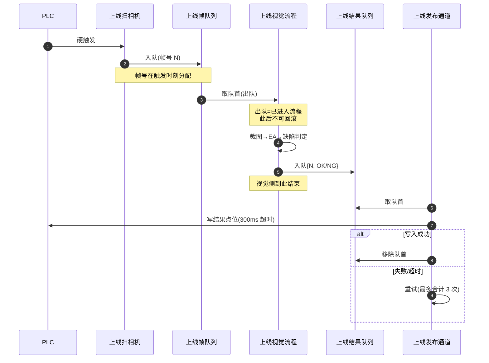
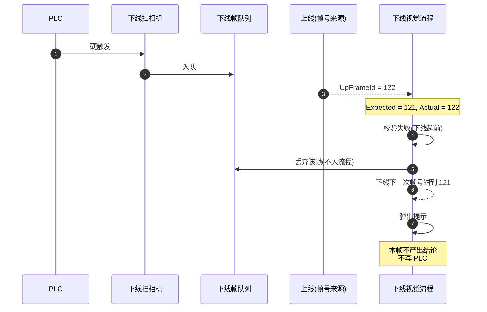
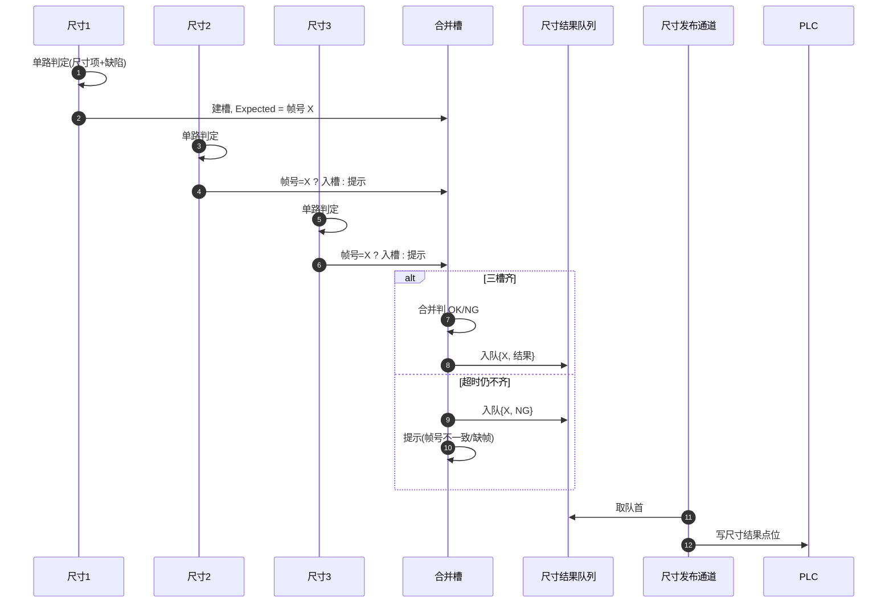
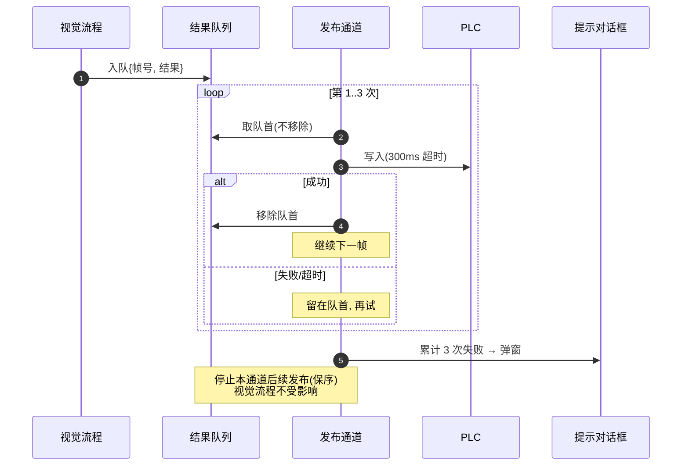

# 五金模切 帧队列与 PLC 结果发布 — 目标形态逻辑设计

> 文档性质：**目标形态的逻辑说明**，不含代码位置、不含改造步骤。
> 适用范围：**仅五金模切**。激光模切的判定、发布、界面必须保持原样。

## 0. 一句话模型

视觉侧按"帧"处理并产出结论；PLC 侧按"帧序"发布结论。
两侧通过**帧号**关联、通过**结果队列**解耦：视觉不等待 PLC，PLC 不反压视觉。

## 1. 术语

| 术语 | 含义 |
|---|---|
| 帧 | 一台相机一次触发产生的一张图 |
| 帧号 FrameId | 产品在该工位的序号，从 1 开始；0 表示"该工位尚未有产品" |
| 工位 | 线扫工位（上线扫 + 下线扫）、尺寸工位（尺寸1/2/3） |
| 帧队列 | 某台相机"已触发、未开始处理"的图，FIFO |
| 结果队列 | 某工位"已判定、未发布"的结论，FIFO |
| 判定 | 视觉流程得出 OK/NG 的过程 |
| 发布 | 把结论写入 PLC 结果点位 |

## 2. 帧号规则（唯一事实来源）

1. 一台相机一次触发 = 一帧；帧号在**图像入队时刻**分配（`CallBackImgDataDeal`）。
   五金由专属 Param 子类覆写该方法，基类 `BaseProParam` 不引入任何五金分支。
   触发时刻只做 50ms 去抖，不占号——触发与图像是两条路径，用触发侧的预测值当 ID，
   丢一张图就永久错位。下文所有"触发时刻分配"一律以此条为准。
2. 帧号**只有一个来源**。禁止同时用"相机采集计数"和"流程处理计数"两套值
   （现实现正是两套，换卷后会永久错位，必须收敛为一套）。
3. 两个工位各自独立编号：线扫工位一套，尺寸工位一套；**同一工位内所有相机共享该工位的编号**。
   线扫的"共享"用 `UpFrameId = DownFrameId + 1` 表达；尺寸的"共享"用**组窗口**表达：
   三路相机的触发在窗口内合并为同一帧号（见 4.2.1），**不允许每相机各自取号**。
4. 帧号在产品通过该工位期间不变；跨相机、跨队列、跨日志都用同一个值。
5. 停止→启动不重置帧号；换卷是否重置由配置决定，但**必须在同一时刻同时重置所有相关计数**。
6. 同组触发（尺寸三路、或某相机 50ms 内的重复触发）必须先合并再取号：
   **一批合并后的触发只允许占用一个帧号**。

## 3. 线扫工位逻辑

### 3.1 帧队列

- 上线扫、下线扫各一条帧队列。
- 触发 → 入队尾；流程线程取**队首**开始处理（**出队发生在处理开始时刻**）。
- 出队即代表"已进入流程"，此后停机/异常**不能回滚该帧**，只能丢弃或判 NG。
- 队列长度 = 待处理积压量，不表示"处理中/已完成"。

### 3.2 帧号不变式

上线扫安装位置更靠前，因此正常运行时：

```text
UpFrameId = DownFrameId + 1
ExpectedDown = UpFrameId - 1
```

下线扫的帧号不是自由计数，而是**由上线扫推导**。

### 3.3 下行帧号校验（在处理之前）

| 比较 | 含义 | 动作 |
|---|---|---|
| `Actual == Expected` | 正常 | 正常处理 |
| `Actual > Expected` | 下线超前（下线比上线先触发 / 计数错乱） | **丢弃该帧**：不入流程；提示；把下线下一次帧号钳到 `Expected`；**另补一条 NG 入下线结果队列**（见决策 10） |
| `Actual < Expected` | 下线滞后（漏触发 / 丢图） | **与上一行同一处理**：丢弃该帧；提示；钳到 `Expected`；补一条 NG |

> `Actual > Expected` 就是需求里"上线 122、下线也 122"的情形：
> 下线必须丢弃这一帧，下一次触发回到 121。

**换卷后的首帧（补充规则，必须实现）**

换卷把所有序号归 1，若此时仍按 `Expected = UpSeq - 1` 校验，下线首帧会得到
`Expected = 0`，而 0 是"尚未有产品"的非法帧号，结果是**换卷后第一片下线必被丢弃**。

因此：换卷完成标志置位后，**下线第一帧无条件放行**，不参与 `Expected` 比较，
放行后立刻恢复 `Expected = UpSeq - 1` 的常规校验。

- 上线不受影响：上线是序号源头，永远按下发号分配。
- 停机→启动不重置序号，因此该规则只在换卷（及同样会重置序号的复位）后生效一次。

### 3.4 处理与结果入队

```text
取队首(出队) → 裁图 → 极片EA → 缺陷判定 → 得到 OK/NG
                                            │
                                            └─→ 对应结果队列：{FrameId, OK/NG}
```

1. 队列移除发生在步骤 1（取队首），不是处理完成之后。
2. 结论入**对应**结果队列：上线结论入上线队列，下线结论入下线队列。
3. 入队完成即视觉侧结束，**不等待 PLC**。

#### 3.4.1 帧结算（一帧一结论）

- 帧被接受即登记"待结算"；以下任一情况都必须结算**且仅结算一次**：
  正常判完、裁图失败、未产出 EA、EA 判定异常、流程抛异常。
- 异常一律结算为 NG。**禁止"无结论"**：结果队列少一条 = PLC 少一拍，
  表现就是机构停在等结果。
- 结算点放在流程的 finally/统一出口，不能只写在成功分支。

#### 3.4.2 A/B 合片（只服务统计）

- 合片配对条件改为**帧号相等**，`FrontSideCount/BackSideCount`（片差）退出。
- 帧号必须从裁图帧一路带到 EA 产品；`EAID` 只做显示，不参与配对。
  原因：`nEAId` 在裁图流程里有多个自增分支，与帧号不是一一对应。
- PLC 结果按线别各自发布，**不依赖合片**；合片只影响统计与界面。
- `Station1_Product` 目前在五金没有消费者（只入队、只清空），随合片改造一并删除。

#### 3.4.3 运行态与代际

- 结果入队前校验两项：**仍在运行**、**代际号一致**；不满足直接丢弃。
- 停机、换卷、复位都自增代际号。
- 目的：清空队列并写 0 之后，不会被"停机瞬间已出队、随后才判完"的迟到结果覆盖。

### 3.5 两条线相互独立

上线扫的判定/发布异常不得影响下线扫，反之亦然。
两条帧队列、两条结果队列、两个 PLC 点位、两个发布通道，互不共享状态。

## 4. 尺寸工位逻辑

### 4.1 无帧队列（已确认）

> **与原始需求的偏差（已由用户确认接受）**：原始需求是"每个相机都有一个帧队列"。
> 尺寸工位不建帧队列，理由是合并槽本身就是 3 槽缓冲，队列没有消费者，
> 多一层缓冲只会增加延迟与错配窗口。合并槽同时承担"缓冲"与"帧号校验"两个职责。

- 三台尺寸相机**不需要帧队列**；触发经去抖与编号后直接进入各自的视觉流程。
- 帧号在入队时按**组窗口**分配（4.2.1），三路同组共用一个号；合并槽只做校验。
- 每台相机只判"本路尺寸项 + 缺陷"，**不判工位 OK/NG**。

### 4.2 合并槽（3 槽 pending，不是队列）

```text
SizePending {
    ExpectedFrameId      // 入队时按组窗口分配，见 4.2.1；不是"第一路完成者决定"
    Slot[cam1..cam3]     // 每路最多一个结果
}
```

- 第一个完成的路建立合并槽，写入 `ExpectedFrameId`。
- 其余两路完成后，必须 `FrameId == ExpectedFrameId` 才能入槽。
- 三槽齐 → 合并三路结果 → 判本片 OK/NG。

#### 4.2.1 尺寸帧号从哪来（必须先定，否则校验失效）

合并槽只**校验**帧号，不**分配**帧号。若帧号由"第一个完成的路"决定，三路天然相等，
"帧号不一致"永远检测不出来——这正是需求第 5 条要抓的故障。

因此尺寸帧号必须在**入队时**产生，规则是：

```text
SizeWindow {
    FrameId     // 本组帧号，取自尺寸工位序号发生器
    OpenedAt    // 窗口开启时刻（本组第一路触发）
    WindowMs    // = SizeStationTimeout，默认 1500ms
}
```

1. 窗口空闲时第一路触发 → 取 `NextSizeSeq` 作为 `FrameId`，开启窗口。
2. 窗口未超时的其余两路 → 复用同一 `FrameId`，不取新号。
3. 窗口超时后才到 → 视为下一组，重新开窗取号，并提示"上一组缺帧"。
4. 合并槽只对这个 `FrameId` 做相等校验。

> 这样"三路各取各号"和"第一路由完成者决定"两种错法都被排除：
> 同组必然同号，不同组必然不同号。

### 4.3 帧号不一致

- 出现 `FrameId != ExpectedFrameId` → **提示**，该帧结果不入槽。
- 继续等"正确帧号"的帧；超过工位等待时间仍不齐 → 本片按 NG 结案并提示。
- 不做"多数表决"：错帧不参与合成，避免把不同产品的数据拼成正确结论。

### 4.4 结果入队

- 合并完成 → 结论入**尺寸结果队列**：`{FrameId, OK/NG}`。
- 本片只入队一次；超时/异常也入队一次 NG，保证 PLC 不会一直等。

## 5. PLC 结果发布

### 5.1 三条队列

| 队列 | 生产者 | 消费点位 |
|---|---|---|
| 上线扫结果队列 | 上线扫视觉流程 | 上线扫结果点位 |
| 下线扫结果队列 | 下线扫视觉流程 | 下线扫结果点位 |
| 尺寸结果队列 | 尺寸三路合并 | 尺寸结果点位 |

### 5.2 发布规则

1. 每条队列一个**独立发布通道**，只取**队首**，保证 FIFO。
2. 写入成功 → 移除队首。
3. 写入超时（`ResultWriteTimeoutMs`，默认 **300ms**）或失败 → 重试，最多再试 2 次（合计 3 次）。
4. 累计 3 次失败 → **非模态提示**（不阻塞界面）；队首保留，该通道**暂停**后续发布（保序），
   避免用后一帧覆盖前一帧尚未发布的结果。恢复由操作员确认后触发。
5. 发布过程与视觉完全解耦：视觉继续处理、继续入队，只受队列深度上限约束。
6. 三条通道**共享同一个 PLC 实例与同一条连接**（五金只有一个 `Server_五金模切PLC`）。
   因此"独立通道"指**队列与状态机独立**，不是各开一条 socket：
   写动作由**每 PLC 一个写调度器（单写线程）**串行执行，心跳优先、结果次之。
   否则三条通道并发写同一连接，报文可能交错。
7. **心跳不能被一次写超时饿死**——这是对"心跳优先"的修正。
   心跳周期 1s，而单次写超时若为 2000ms，阻塞中的那一次写会跨过两个心跳周期；
   优先级只在"取下一个任务"时生效，管不了正在阻塞的调用。
   因此调度器对**结果写的单次超时必须 ≤300ms**（3 次重试合计仍 ≤1 个产品节拍），
   或把心跳放到独立的写通道。仅靠"心跳优先"不足以保证通讯不被判断开。

### 5.3 "发送成功"的定义

当前 PLC 协议没有消费回执，"成功"仅表示写入调用成功返回；"超时"表示写入在 300ms 内未返回。
本文不把"写入成功"等同于"PLC 已使用该结果"。

### 5.4 待检值（3）

- 待检**在"分配帧号"处投递**，不在相机帧开始回调投递：
  帧开始回调早于图像回调，此刻还没有帧号，无法与该帧结论配对。
- 待检与结论成对入同一条结果队列：`Pending(N)` → `Result(N)`。
- 去抖丢弃的重复触发不分配帧号，因此也不会产生多余的 Pending。
- 若在帧开始处直接写 3（不入队），队列积压时下一帧的待检会覆盖上一帧尚未发布的结论。

### 5.5 队列深度

- PLC 侧是标量点位，只能读"当前值"，所以队列不能无限增长。
- 深度超过阈值 → 提示（说明发布速度跟不上视觉产出）。
- 深度上限是**设计参数**，不是"落后几拍"的固定值。

### 5.6 与视觉的时序关系

- 硬约束只有一条：`发布(帧N)` 必然晚于 `判定结束(帧N)`。
- 实际时延 = 该结果在队列里的排队时间，由"视觉产出速率 vs 发布速率"决定。
- 稳态下发布只是一次短整型写入，通常远小于一个产品节拍，观感上"落后一拍"，但不是固定值。
- 真正的约束是**顺序**和**不覆盖**，不是固定延迟。

## 6. 状态归属与并发约束（逻辑层）

| 数据 | 写者 | 读者 | 约束 |
|---|---|---|---|
| 帧队列 | 入队线程 | 流程线程 | 单消费者；清空不得与出队竞争 |
| 尺寸合并槽 | 三路流程 | 第一路（等待方） | 同一槽只允许一个写者进入临界区 |
| 结果队列 | 各视觉流程 | 对应发布通道 | 单生产者 / 单消费者，FIFO |
| 代际号 | 停机/换卷/复位 | 全链路 | 只增；旧代际结果入队即丢弃 |
| PLC 点位 | **仅写调度器**（发布通道只提交） | PLC | 每 PLC 单写线程串行；每点位独立状态，不共用全局锁 |
| 帧号 | 入队线程 | 全链路 | 单一来源，只增不减；异常时按规则钳位 |

三条硬约束：

1. **PLC 写操作不得出现在相机回调线程或视觉线程上。**
2. **写动作必须串行，且不需要点位级锁**：若三条结果通道与心跳各自加锁并发写同一条连接，
   报文会交错；若共用一把锁，一次长超时又会饿死心跳。两者同时成立的做法只有一个：
   **每 PLC 一个写调度器（单写线程）串行执行**，结果通道按 FIFO 轮流取队首、心跳最高优先，
   调度器内部用一把"队列等待锁"保护任务入队，**不再按点位拆锁**（串行即天然互斥）。
   配套约束见 5.2 第 7 条：结果写单次超时 ≤300ms。
3. **发布重试不得计入既有"写失败次数过多"停机报警**：
   PLC 层是"第 3 次失败即停机报警"，与"3 次失败只提示、不停机"的决策冲突，
   必须隔离计数口径或让发布通道不参与该判定。

## 7. 仿真

### 7.1 触发时序

一个产品节拍内：

| 时刻 | 事件 |
|---|---|
| `t0` | 上线扫触发 |
| `t0 + 500ms` | 下线扫触发 |
| `t0 + 2500ms` | 尺寸三路同时触发（线扫两路都触发后再等 2000ms） |

> "线扫均帧触发后等 2s"我按"上线 + 下线都出图后再等 2s"理解；
> 若你的意思是"上线触发后 2s"，应改为 `t0 + 2000ms`。

### 7.2 界面（替换现有日志页）

两个 Tab，不再显示滚动日志。

**线扫工位**

| 行 | 显示内容 |
|---|---|
| 上线扫 | 队列帧号、处理中帧号、最近完成帧号、结果队列帧号、发布状态与重试次数 |
| 下线扫 | 同上 + 帧号校验状态（正常 / 丢弃 / 滞后） |

**尺寸工位**

| 行 | 显示内容 |
|---|---|
| 尺寸1 / 2 / 3 | 当前处理帧号、是否已入槽 |
| 合并 | 期望帧号、已到 x/3、校验结果、本片 OK/NG |
| 尺寸发布 | 结果队列帧号、发布状态与重试次数 |

### 7.3 自动模式

- 自动模式：**不提供人工启动/停止按钮**；运行由 PLC 自动信号 + 帧触发驱动。
- 仿真模式：保留启动/停止按钮，仿真需要人为开始。
- 该差异只对五金生效，不影响激光。

## 8. 时序图

### 8.1 线扫正常流程



### 8.2 下线帧号超前



### 8.3 尺寸三路合并与帧号校验



### 8.4 发布重试与失败提示



### 8.5 仿真节拍

```mermaid
gantt
    title 单产品仿真节拍
    dateFormat X
    axisFormat %L ms
    section 线扫
    上线扫触发      :a1, 0, 120
    下线扫触发      :a2, 500, 620
    section 尺寸
    尺寸1/2/3 触发  :b1, 2500, 2620
    section 视觉
    线扫判定        :c1, 620, 1200
    尺寸判定与合并  :c2, 2620, 3400
```



## 9. 明确不做的事

1. 不改激光模切的判定、发布与界面。
2. 不做历史帧补发：失败的帧只重试队列里的这一条。
3. 不做跨工位帧号联动：线扫与尺寸各自编号。
4. 不在视觉线程里等待 PLC。
5. 帧号异常时不做"猜测性对齐"：只丢弃 + 钳位 + 提示。

## 10. 已确认决策

| # | 决策 |
|---|---|
| 1 | 下线 `Actual < Expected` 与 `Actual > Expected` **同处理**：丢弃该帧、提示、帧号钳到 `Expected` |
| 2 | 发布累计 3 次失败：**暂停该队列**，队首保留，等操作员确认后恢复 |
| 3 | "待检值 3" **保留**，与结论成对入同一结果队列 |
| 4 | 仿真尺寸触发：从**下线触发**起算 2s，即 `t0 + 500ms + 2000ms = t0 + 2500ms` |
| 5 | **换卷重置帧号**（所有工位序号同时归 1） |
| 6 | 同一相机连续两次触发间隔 **≤50ms 只取最初一帧**，被丢弃的触发不占帧号 |
| 7 | 提示对话框**非模态**，不阻塞视觉与发布线程 |
| 8 | 尺寸帧号在**入队时按组窗口**分配（4.2.1），合并槽只校验不分配 |
| 9 | PLC 写动作由**每 PLC 一个写调度器**串行执行；三通道只独立队列与状态机 |
| 10 | 下线钳位导致"该片无结论"时**补一条 NG**，保证 PLC 每片必有一拍 |
| 11 | 写超时已实测：库默认 5014ms，两个超时属性设 300ms 后 313ms 返回；**不需要包装重载**，改为配置超时 + 失败计数隔离（见 实施 6.4） |
| 12 | "单次写超时 2000ms"改为**结果写单次 ≤300ms × 3 次**：2000ms 会跨两个心跳周期（1s），必然判通讯断开 |
| 13 | 换卷后**下线首帧无条件放行**，不参与 `Expected` 校验（否则首片必丢） |
| 14 | 钳位丢帧后**补一条 NG** 入下线结果队列（§3.3 与本节原表述冲突，以本条为准） |
| 15 | 尺寸工位**不建帧队列**，由合并槽承担缓冲与帧号校验（与原始需求不同，已确认接受） |
| 16 | 下线滞后（`Actual < Expected`）同样**丢帧 + 钳位**，不重新编号、不猜测对齐 |

> 决策 6 的补充说明：去抖必须作用在"图像入队"这一步，
> 而不是只作用在触发事件上；否则图仍会进队列，帧号与实际图数量会再次分叉。